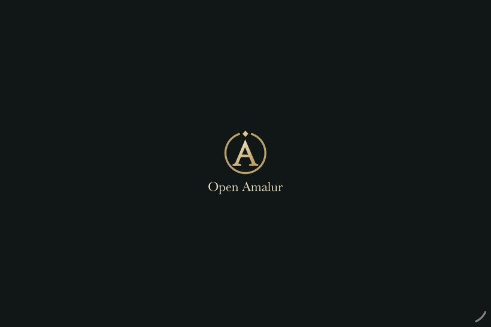
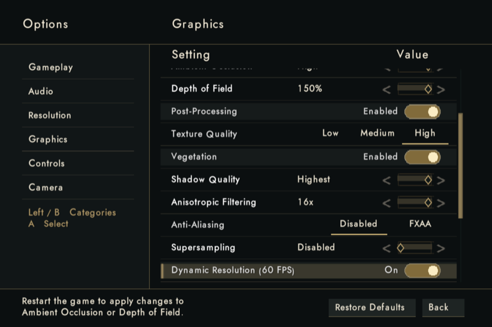
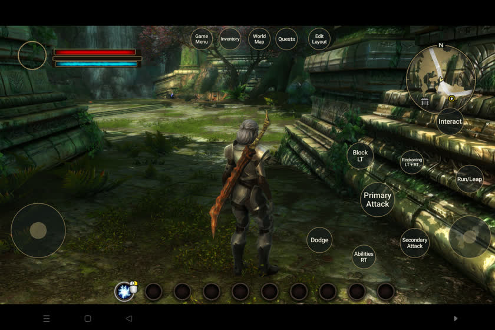
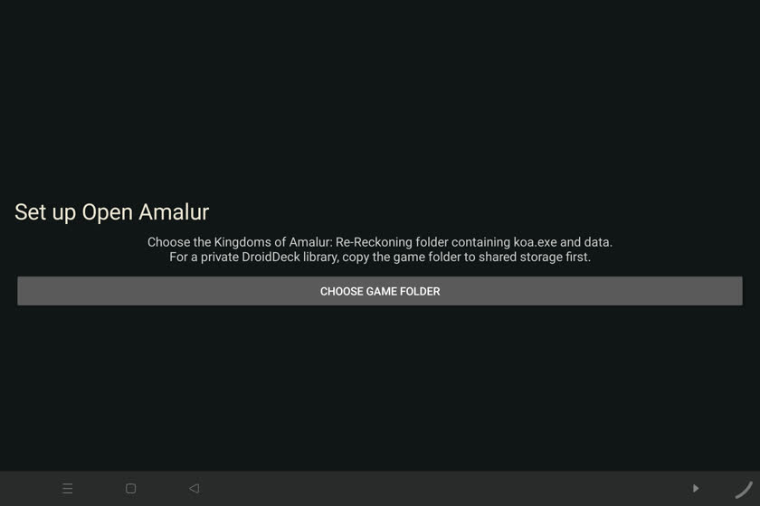
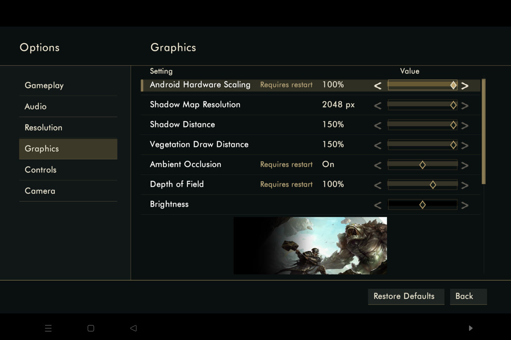

Right. Let’s get this out of the way so we don’t waste each other’s time.

This started as a personal experiment. I wanted to see if I could use AI to get *Kingdoms of Amalur: Re-Reckoning* running natively on Android.

Open Amalur is unequivocally an AI-first project. I led the work and used ChatGPT, Claude, and Qwen throughout. If that’s a deal-breaker for you, this is your cue to walk away.

Open Amalur is a recompilation of the original *Re-Reckoning* engine. The translator and runtime are open source. Starting with v0.1.6, the APK includes the prebuilt ARM64 engine and sets up the game offline using files from your copy.

I substantially reworked the engine’s threading to improve how it schedules simulation, rendering, and background jobs across multiple CPU cores.

Android is available now. The Windows version is in testing, and I plan to build a macOS version. Some of the work on threading, graphics, and the interface could also carry over to Linux and iOS if someone wants to take it there.

## About the UI

The UI got a huge overhaul. I loathed the original interface with a passion, and this was my chance to change it. So I did.

Veil draws visual inspiration from other interfaces, including Edge for Skyrim. I developed the UI changes and the other enhancements for Open Amalur without downloading, sampling, or reusing files or code from those mods.

## Download and install

**Open Amalur for Android v0.1.35** · [Download the latest APK](https://github.com/Mokomis/open-amalur-android/releases/latest) · [v0.1.35 release notes](https://github.com/Mokomis/open-amalur-android/releases/tag/v0.1.35)

Special thanks to **oblivium-beep for the continued help with touch ui testing!**

### Minimum Android requirements

- **64-bit Arm and Android 13 or newer** for gameplay with the system Vulkan driver. The APK targets `arm64-v8a`. The setup screen itself requires Android 11 or newer. [Android Vulkan support](https://developer.android.com/games/develop/vulkan/native-engine-support#determine-the-available-vulkan-api-version)
- **Vulkan 1.3 or newer** with dynamic rendering (`dynamicRendering`) and BC texture compression (`textureCompressionBC`). The regular APK uses the system graphics driver. It also requires Android surface and swapchain support, sampler anisotropy, depth clamp and depth bias clamp, independent and dual-source blending, non-solid fill modes, and robust buffer access. [Renderer requirements](https://github.com/Mokomis/open-amalur-android/blob/v0.1.26/native/experiments/ff1850-threading/O67-ORIGINAL-UI/veil-apk-update/oa_vk_fullscreen.c#L3926) · [Required Vulkan features](https://github.com/Mokomis/open-amalur-android/blob/v0.1.26/native/experiments/ff1850-threading/O67-ORIGINAL-UI/veil-apk-update/oa_vk_fullscreen.c#L3987-L3997)
- **Game files and free storage.** A complete copy of *Kingdoms of Amalur: Re-Reckoning*, plus about **1.5 GB of additional free space** on the selected volume for Veil and app data. Android may also need internal storage to install the APK. The tested PC release is `cs:15032` (Steam build `10619381`). [Game files](#game-files)
- **Memory.** During gameplay on the OPPO Pad Mini, Open Amalur used about **1.7 GB**: 0.86 GB of app memory and 0.82 GB of GPU memory, in the opening dungeon at 50% Hardware Scaling. Larger areas and higher render resolutions use more. **6 GB of RAM or more is recommended.** 4 GB devices are untested and may close the game when Android runs short of memory.

Minimum chipset requirements are still unverified. See the device results below.

### Install or update

To update, install the new APK over your existing Open Amalur app to keep your saves, settings, and touch layout. The first launch after an update may show **Verifying Veil** while the app checks the updated menu files.

For a new setup on a device that meets the requirements above:

1. Install the APK on your Android device. Put your Re-Reckoning game folder in shared storage on the device or SD card.
2. Open Open Amalur and choose **Set up and play from internal storage** or **Set up and play from SD card**. Select the folder containing `koa.exe` and `data` on that same volume.
3. When Android asks, grant **All files access** so the game can open the original archives. Setup prepares Veil and opens the main menu. Once the APK and game files are on the device, setup and play work offline.

### Android hardware compatibility

| Device | GPU | Open Amalur status |
| --- | --- | --- |
| OPPO Pad Mini (OPD2515) | Adreno 829 | Tested on v0.1.27 with the system driver. Verified setup, the main menu, menu navigation, character naming, and a Razer Kishi V3 Pro controller with rumble. |
| AYN Thor Max (16 GB) | Adreno 740 | [A player reported it working](https://github.com/Mokomis/open-amalur-android/issues/1#issuecomment-6949032454) after the character creation fixes on an earlier release. |
| Retroid Pocket 5 | Adreno 650 | The tester’s system driver exposed Vulkan 1.1. DD-Turnip reached gameplay with Vulkan 1.3. A later GPU crash is under investigation. [Latest Retroid test APK](https://github.com/Mokomis/open-amalur-android/releases/tag/v0.1.26-retroid-turnip-tutorial) |
| POCO X7 Pro | Mali-G720 | Startup failure reported with the regular APK. The [PanVK test APK](https://github.com/Mokomis/open-amalur-android/releases/tag/v0.1.26-poco-panvk) reached the tutorial. [Rendering problems are under investigation](https://github.com/Mokomis/open-amalur-android/issues/3). |

For compatibility reports, include your exact device model, Android version, Open Amalur version, and the last screen you saw. Add a crash report ZIP if available.

### Game files

Copy your complete **Kingdoms of Amalur: Re-Reckoning** game folder to shared storage on your Android device or SD card, or select it where it already lives. Choose the folder that contains `koa.exe`, `binkw32.dll`, and `data/`. Leave the original archives and videos in that folder structure, including `data/videos/well.bik`. The tested PC files are from game version `cs:15032` (Steam build `10619381`).

For files stored inside another app's private folder, first copy the game folder to a location such as `Documents/Amalur` on the volume you'll use. [Save imports from GameNative or DroidDeck](#import-saves-from-gamenative-or-droiddeck) are available separately from the main menu.

Setup uses the existing game folder and needs about **1.5 GB of additional free space on that volume** for Veil and app data. With SD card setup, the game files, Veil archive, and saves live on the card. Android may still need space on internal storage to install the APK. Keep the card inserted while playing. Removable SD card setup still needs device testing.

Existing imports retain their original location, including imports created on Android 10. Back up saves before uninstalling Open Amalur because Android removes its app data.

### Send crash logs

Choose **Send Crash Report** from the main menu. If a crash prevents you from reaching the menu after relaunching, [open an issue](https://github.com/Mokomis/open-amalur-android/issues) with your device model, Android version, and the last screen you saw.

Android's share sheet lets you save or send the ZIP. It contains recent sections of `pc-runtime.log` and `oa-vulkan.log` from up to two runs, device and app details, and available Android crash records. The ZIP excludes saves and game archives.

### Import saves from GameNative or DroidDeck

On the main menu, select **Import Saves** below **New Game** and choose your source.

- **GameNative:** Export the game's files, then select the `svd_fmt_*.sav` files from the export under `Download/GameNative/`.
- **DroidDeck:** Open DroidDeck once, then choose **DroidDeck** in Android's file picker. Turn on **Show hidden files** to see `.local`. Select the `svd_fmt_*.sav` files from `files/linuxfs/root/.local/share/Steam/userdata/<account>/1041720/remote/autocloud/save/`.

Restart Open Amalur after importing, then open **Load Game**. Open Amalur backs up any saves with matching filenames to its `offline-saves/import-backups` folder before replacing them.

### Fatesworn

Choose **DLC Status** from the main menu to check whether Fatesworn is installed. To add it when playing from the original game folder, put the supported `data_1278260/dlc_mit_0.pak` archive in that folder and restart. With an older Open Amalur import, choose **DLC Status → Add Fatesworn** and select the updated game folder or its `data_1278260` folder, then restart.

## How the engine runs

We built the **native ARM64 engine** by translating the original executable’s x86 machine code into C and compiling it for Android. It uses the game’s original data formats and scripts.

- **Engine behavior.** We used matched inputs to compare the Android build with the original PC game, checking instruction handling, floating-point behavior, animation blending, skinning, and GPU submission.
- **Android integration.** The runtime provides file access, input, audio, local profiles, saves, and display handling. The graphics layer translates the engine’s Direct3D 11 calls to Vulkan. The native `D3DReflect` implementation reads metadata from the game’s compiled shaders.
- **Multicore threading.** We reworked how the engine discovers available CPU cores, synchronizes jobs, and wakes workers as jobs finish. We profiled simulation, graphics recording, and background work across multiple cores on the OPPO Pad Mini.

On the OPPO Pad Mini, testing covered setup, launching to the main menu, menu navigation, and character naming. The full campaign and expansion still need broader playtesting.

[Engine and threading notes](ENGINE.md) · [v0.1.26 source](https://github.com/Mokomis/open-amalur-android/tree/v0.1.26) · [Developer build guide](https://github.com/Mokomis/open-amalur-android/blob/v0.1.26/BUILDING.md#build-from-source)

## Added features

### Veil interface

Veil uses compact lists and a consistent set of buttons, tabs, and prompts across the menus. The APK includes the animated Allestar Glade waterfall used in Veil portraits. The menu font is Jost. [Edge UI](https://www.nexusmods.com/skyrimspecialedition/mods/130983) · [Jost license](android/licenses/Jost-OFL.txt)

- **Home and Options** support switching between controller, touch, and mouse on the same screen. Options opens on the category list. Use Up/Down to browse and Right or A to enter a category. Press A on a numerical setting, use Left/Right to adjust it, then press A to finish. B returns to categories. Touch or click the controls beside a setting to change it directly.
- **Inventory, stash, and equipment** with compact item lists, a separate details pane, equipped-item markers, and appearance controls. Consumables can be mapped to the Item Radial. Weapons use Primary and Secondary slots.
- **Character and progression screens** for stats, skills, abilities, destinies, and character creation. Character creation uses Veil-framed portraits and a single **Use name** confirmation with the Android keyboard.
- **Quest log and maps.** View quests and objectives side by side. On the local or world map, spread two fingers to zoom in or pinch to zoom out. To mark a point of interest, hold its icon still for half a second, then lift. Repeat on the marked icon to remove the waypoint.
- **Beds and quantity prompts.** Tap the track, drag the handle, or tap **−** and **+** to choose an amount. Use the labeled buttons to confirm or cancel.
- **Aggressive Mode.** Tap **Sneak** near a friendly NPC. When the game offers Aggressive Mode, tap the **Aggressive Mode** touch button or press **D-pad Up** on a controller.
- **Save and load** with full-screen slots and a touch action for creating or overwriting a save. Tap a slot to load it. Loading from the pause menu and overwriting a save both keep the game's confirmation prompt.
- **Dialogue** with tap selection, a draggable wheel in conversations that use one, and an on-screen Skip control.
- **Trading, stash, and NPC services** include repair, training, and healing. At a merchant, tap an item and use **Buy**, **Sell**, or **Compare** at the bottom of the screen. Veil also covers alchemy, blacksmithing, sagecrafting, lockpicking, and the timed Dispel screen.

### Gameplay and controls

- **Transmog** changes the look of equipped armor and same-type weapons, such as a sword taking the appearance of another sword. The equipped item retains its stats. Appearance choices are saved with the character.
- **Tablet controls** provide separate movement and camera sticks, Run/Leap, attacks, dodge, block, interaction, and shortcuts for the game menu, inventory, world map, quests, and Item Radial. Drag the right stick to look around. Holding it still sends the same camera command as clicking the right stick on a controller. For persistent tracking, turn on **Options → Camera → Touch Enemy Lock-On** (off by default). Hold the right touch stick to lock onto an enemy, then lift your thumb. A lock appears on the stick while tracking. Hold again to release. Tap **Sneak** to crouch or stand. When picking a lock, use the on-screen **Pick** arrows to set the angle and the **Bolt** arrows to move the bolt.
- **HUD size** in Options → Gameplay offers Default, Small, and Hidden. Selecting Default or Small restores the gameplay HUD, even if that size is already selected.
- **Quick Save** on the gameplay screen writes to the regular quick-save slot whenever the game allows saving. Open **Load Game → Quick Save** to resume.
- **Touch layout editor** lets you move each control and set its size and opacity independently. Tap **Edit Layout**, tap a control, adjust **Opacity**, and tap **Done**. Controls set to 0% are still visible in the editor.
- **Spell hotbar.** Open **Game Menu → Abilities**, tap a learned active ability, then tap the numbered slot where you want it. During gameplay, tap a populated slot once to cast, even while holding the touch movement stick. The separate **Cast** button repeats the selected spell. Normal mana costs and cooldowns apply. Tapping an empty slot leaves your selection alone.
- **Reckoning and tutorial controls** include on-screen LT and RT prompts, touch finishers, and Continue buttons on screens that require a controller button or key.
- **Controller support** covers gameplay, menu navigation and vibration on controllers that expose a vibrator to Android.
- **Camera Bounding** limits how far the camera pulls back during group fights.
- **Outdoor ambience** plays occasional wildlife sounds according to the in-game clock. Day Ambience and Night Ambience have separate switches in Audio and follow Effects Volume. Wildlife gets quieter during loud game effects.

### Graphics and Android integration

- **Resolution** lists the display sizes Android reports, plus the current window size and performance presets. Restart the game after choosing a different resolution.
- **Android Hardware Scaling** offers Off, 25%, 50%, 75%, and 100%. The setting defaults to 100% and takes effect after a restart. Choose **Native** resolution to match the display’s aspect ratio for gameplay and in-engine cinematics.
- **Dynamic Resolution (60 FPS)** is under Options → Graphics and defaults to Off. Turn it on during SDR gameplay to target 60 FPS. It uses your configured render size, including Android Hardware Scaling, as its ceiling. Under load it can step down to five-sixths or two-thirds of each dimension, then step back up when there is headroom. The switch takes effect during play.
- **Reduce Resolution When Hot**, directly below Dynamic Resolution, defaults to Off, including on upgrade. Enable both switches to let Android’s heat reading lower the resolution early and allow it to recover as the device cools. With only Dynamic Resolution enabled, frame times determine the render size. The game remembers each switch separately.
- **CPU Performance Hints** defaults to Off, including when upgrading from 0.1.28. Enable it to tell Android how much CPU time drawing and simulation take against a 60 FPS target. Android can lower CPU clocks when it sees spare time. In one-minute OPPO Pad Mini tests on a 120 Hz display, enabling hints reduced average FPS from 95 to 90 (about 5%). The 95th-percentile frame time was nearly identical. Results can vary by device. The switch works independently of Dynamic Resolution and takes effect during play. [OPPO measurements](https://github.com/Mokomis/open-amalur-android/commit/b3a938653d67bcc05ffa9289058d881f6424b75d)
- **Shadow Map Resolution** offers 512, 1024, 1536, and 2048 px.
- **Shadow Distance** and **Vegetation Draw Distance** each offer 75, 100, 125, and 150 percent.
- **Ambient Occlusion** offers Off, On, and High. **Depth of Field** offers 0, 50, 100, and 150 percent. The menu identifies settings that take effect after a restart.
- **Startup** shows the Open Amalur logo and name while the game loads, then opens the main menu.
- **Direct setup** uses the existing Re-Reckoning folder on internal storage or SD card and prepares Veil automatically.
- **GitHub release status** appears on the main menu and links to the release page when a newer version is available.

### Screenshots

The startup and Graphics screens below show v0.1.26 on the OPPO Pad Mini.

| Startup | Graphics settings |
| --- | --- |
|  |  |

The following screenshots are from v0.1.5. Select an image to open it at full size.

| Touch controls | Inventory and equipment details |
| --- | --- |
|  |  |
| **Character screen** | **Quest log** |
|  |  |
| **Dialogue options** | **Save screen** |
|  |  |
| **Title screen and update status** | **First-launch folder setup** |
|  |  |
| **Veil Graphics** | |
|  | |

Open Amalur is a fan project and is independent of THQ Nordic and Kaiko.

## AI contributors

- ChatGPT
- Claude
- Qwen
