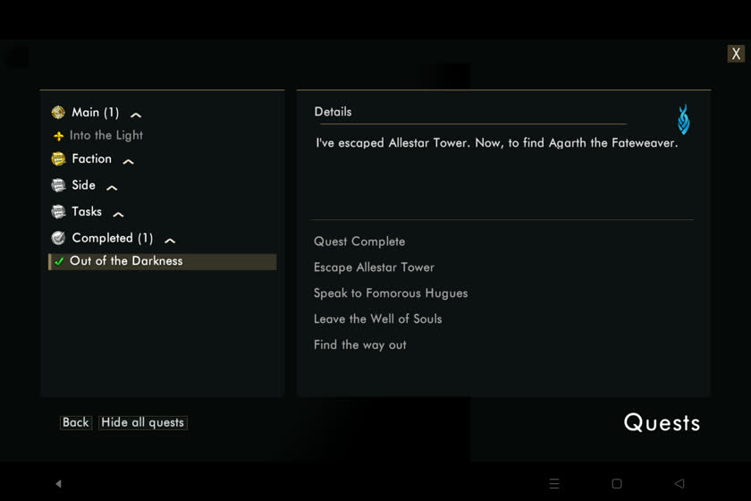
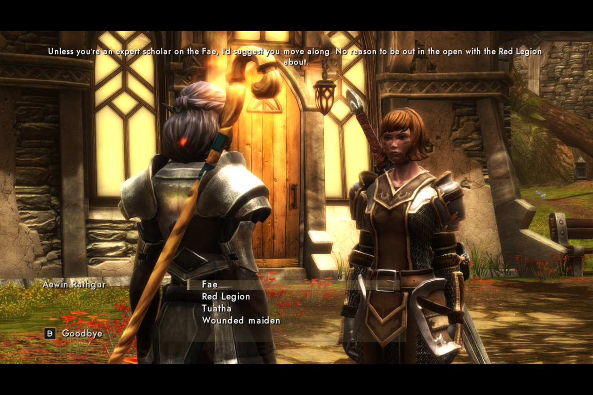
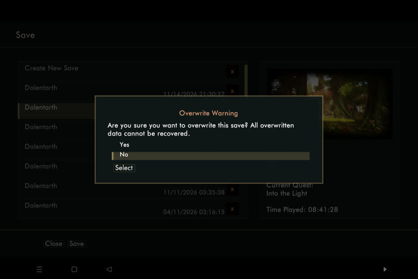
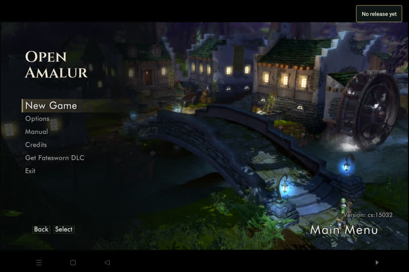

# Open Amalur for Android

Open Amalur is an unofficial Android project for **Kingdoms of Amalur: Re-Reckoning**. Its aim is to preserve the PC game's combat, quests, characters, and world while making the game practical to play on a tablet with touch controls or a controller.

This repository is the project page for the current original-engine work. The earlier [Open Amalur research archive](https://github.com/Mokomis/open-amalur) remains available. The first downloadable build is being prepared. Supported game versions and installation instructions will accompany the release.

## How the engine runs

The first approach reconstructed parts of the engine from the game's data. It made selected locations playable, but the work exposed how much behavior and rendering would need to be recreated. The current project starts from the original Windows x86 engine and uses its behavior on Windows as a reference.

1. Recover and test bounded parts of the original engine. The early comparisons followed animation jobs through expression evaluation, blend trees, transforms, skinning, and GPU submission. The tests checked Windows results against the original x86 program and then ran the corresponding compiled code on ARM.
2. Repair the x86-to-C translation path. We qualified instruction handling, register and flag behavior, floating-point operations, and Windows calling conventions against the original program. The current Android build compiles translated code to ARM64 ahead of time.
3. Provide the Windows services the game expects. Android adapters handle threads and synchronization, file access, input, audio, local profiles and saves, and window and surface events. The graphics layer maps the game's Direct3D 11 work to Vulkan. On-device tests progressed from isolated scenes and captured graphics to live gameplay.
4. Rebuild the original engine’s threading for Android. A substantial part of the port went into getting the original engine to distribute its work across multiple ARM CPU cores. We rebuilt the Windows threading and synchronization services the engine relies on, corrected how it discovers available cores, and changed how waiting workers are notified when jobs complete. We profiled the simulation, graphics recording, and background workers on the OPPO against matched gameplay scenes.

The live tests so far are concentrated on the OPPO Pad Mini. Performance varies with scene, resolution, device, and temperature. Compatibility across the full campaign and the Fatesworn expansion is still being checked.

[Read the engine and threading notes](ENGINE.md) · [Build the Android native library](BUILDING.md).

## Added features

### Veil interface

Veil takes its visual cues from Edge UI for Skyrim. It uses compact lists, full-screen layouts, and a consistent set of buttons, tabs, prompts, and type. [Edge UI](https://www.nexusmods.com/skyrimspecialedition/mods/130983)

- **Main and pause menus** with a redesigned options sidebar and dedicated settings lists.
- **Inventory, stash, and equipment** with compact item lists, a separate details pane, equipped-item markers, and appearance controls.
- **Character and progression screens** for stats, skills, abilities, destinies, and character creation. The character portrait has an animated waterfall backdrop from the game.
- **Quest log and maps** with side-by-side quest lists and objectives, Veil map controls, and touch confirmation for quest tutorials.
- **Save and load** with full-screen slots and a touch action for creating or overwriting a save. Overwriting keeps the game's confirmation prompt.
- **Dialogue** with tap selection, a draggable dialogue wheel, and an on-screen Skip control.
- **Trading, stash, and NPC services** including buying, selling, repair, training, and healing. Veil also covers alchemy, blacksmithing, sagecrafting, lockpicking, and the timed Dispel screen.

### Gameplay and controls

- **Transmog** changes the look of equipped armor and same-type weapons, such as a sword taking the appearance of another sword. The equipped item retains its stats. Appearance choices are saved with the character.
- **Tablet controls** provide separate movement and camera sticks, Run/Leap, attacks, dodge, block, interaction, abilities, and shortcuts for the game menu, inventory, world map, and quests.
- **Touch layout editor** moves and resizes individual controls and saves the layout.
- **Ability and Reckoning controls** include a tappable 1–9/0 ability bar, on-screen LT and RT prompts, touch finishers, and Continue buttons on screens that require a controller button or key.
- **Controller support** covers gameplay and menu navigation. Prompts follow the active input method.
- **Camera Bounding** limits how far the camera pulls back during group fights.

### Graphics and Android integration

- **Android Hardware Scaling** offers Off, 25%, 50%, 75%, and 100%. The setting defaults to 100% and takes effect after a restart.
- **Shadow Map Resolution** offers 512, 1024, 1536, and 2048 px.
- **Shadow Distance** and **Vegetation Draw Distance** each offer 75, 100, 125, and 150 percent.
- **Ambient Occlusion** offers Off, On, and High. **Depth of Field** offers 0, 50, 100, and 150 percent. The menu identifies settings that take effect after a restart.
- **Direct startup** skips the intro videos and the press-any-key screen.
- **First-launch import** uses Android's folder picker to copy a supported PC installation into Open Amalur, with local profiles and saves.
- **GitHub release status** appears on the main menu and links to the release page when a newer version is available.

Fatesworn support is under test.

### Screenshots

Captured on the OPPO Pad Mini. Select an image to open it at full size.

| Touch controls | Inventory and weapon appearance |
| --- | --- |
|  |  |
| **Character screen** | **Quest log** |
|  |  |
| **Dialogue wheel** | **Save confirmation** |
|  |  |
| **Title screen and update status** | **First-launch folder setup** |
|  |  |
| **Veil Graphics** | |
|  | |

## Game files

You will need your own supported PC installation of Re-Reckoning. This repository contains the project source, native build instructions, and documentation. Commercial game files, extracted game assets, generated engine translations, saves, and signing keys stay private.

The tested candidate recognizes Steam build 10619381 of Re-Reckoning. First-launch setup asks for the game folder and the matching 32-bit Microsoft DirectX shader compiler file. Keep the English, French, and German game archives together because the engine opens all three at startup. Keep `data/videos/well.bik` in the source folder for the animated main menu. Setup can restore that file to an existing install.

The importer reads the selected folder directly. Steam, a Steam sign-in, and an internet connection are unnecessary for play. The update badge uses GitHub when a connection is available. Setup can read the matching DirectX compiler DLL from the selected folder, or you can select it separately. A supported `data_1278260/dlc_mit_0.pak` in the selected folder is imported as Fatesworn.

The Android folder picker can see game folders on shared storage. If your DroidDeck library is installed inside DroidDeck's private storage, copy the game folder into a shared Steam library or a folder such as `Documents/Amalur` before importing. [Android file picker access](https://developer.android.com/training/data-storage/shared/documents-files) · [DroidDeck](https://github.com/Droid-Deck/DroidDeck)

Open Amalur is a fan project and is independent of THQ Nordic and Kaiko.
