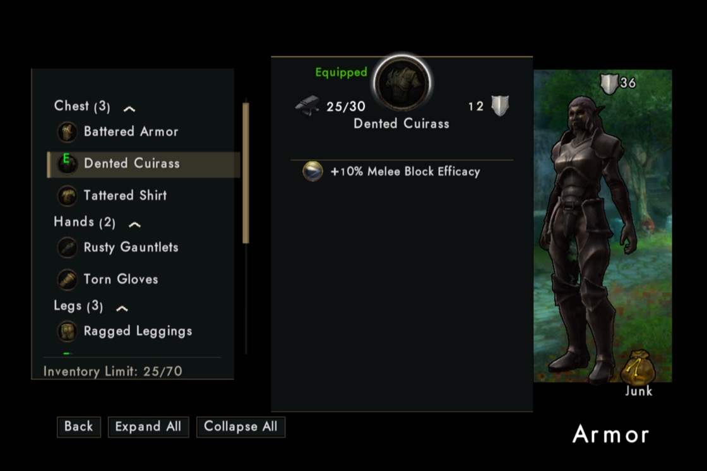
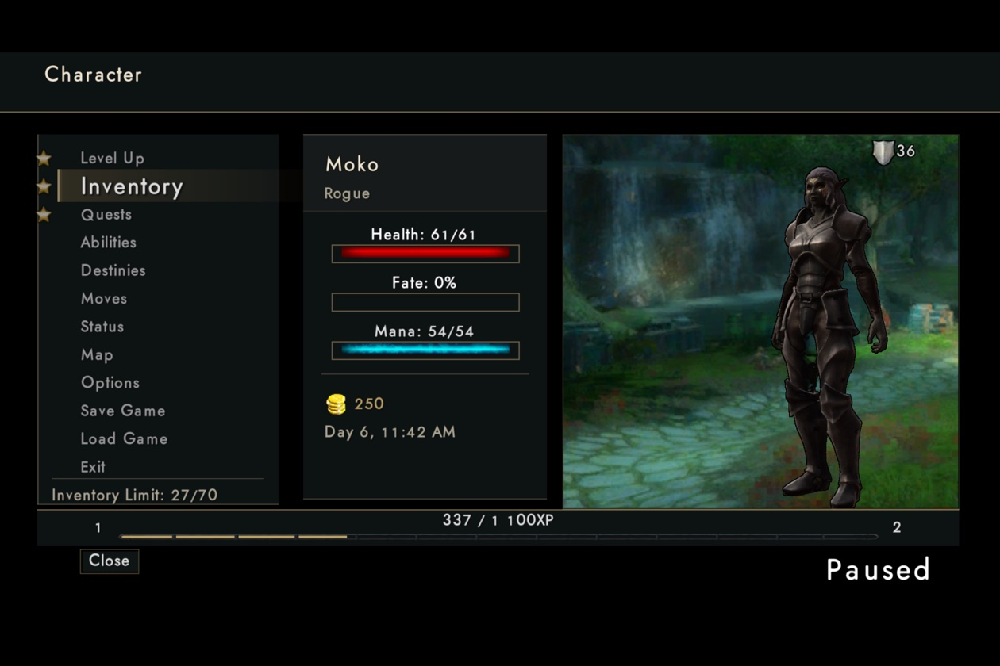

# Open Amalur

Right. Let’s get this out of the way so we don’t waste each other’s time.

This started as a personal experiment. I wanted to see if I could use AI to get *Kingdoms of Amalur: Re-Reckoning* running natively on Android.

Open Amalur is unequivocally an AI-first project. I led the work and used ChatGPT, Claude, and Qwen throughout. If that’s a deal-breaker for you, this is your cue to walk away.

Open Amalur is a recompilation of the original *Re-Reckoning* engine. The translator and runtime are open source. The Android app runs the prebuilt engine with the game files from your own copy.

I substantially reworked the engine’s threading to improve how it schedules simulation, rendering, and background jobs across multiple CPU cores.

Android is the first release. I plan to build a Windows version next. Some of the work on threading, graphics, and the interface could also carry over to macOS, Linux, and iOS if someone wants to take it there.

## About the UI

The UI got a huge overhaul. I loathed the original interface with a passion, and this was my chance to change it. So I did.

Veil draws visual inspiration from other interfaces, including Edge for Skyrim. I developed the UI changes and the other enhancements for Open Amalur without downloading, sampling, or reusing files or code from those mods.

## Download and install

1. On your Android device, download the APK from [GitHub Releases](https://github.com/Mokomis/open-amalur-android/releases/latest) and install it.
2. Open Open Amalur and select the Re-Reckoning folder containing `koa.exe` and `data`.
3. Starting with v0.1.5, setup downloads the prebuilt ARM64 engine and any required support file, imports your game files, and opens the game. Internet access is needed for the first setup. You can play offline afterward.

## How the engine runs

Open Amalur runs the original game engine as a **native ARM64 Android library**. The project’s build tools translate the original game executable’s x86 machine code into C and compile it for Android. Setup downloads the resulting library, then runs it on the tablet with the original game data and scripts.

- **Engine behavior.** We used matched inputs to compare the Android build with the original PC game, checking instruction handling, floating-point behavior, animation blending, skinning, and GPU submission.
- **Android integration.** The runtime provides file access, input, audio, local profiles, saves, and display handling. The graphics layer translates the engine’s Direct3D 11 calls to Vulkan.
- **Multicore threading.** We reworked how the engine discovers available CPU cores, synchronizes jobs, and wakes workers as jobs finish. We profiled simulation, graphics recording, and background work across multiple cores on the OPPO Pad Mini.

The live tests so far are concentrated on the OPPO Pad Mini. Performance varies with scene, resolution, device, and temperature. Compatibility across the full campaign and the Fatesworn expansion is still being checked.

[Read the engine and threading notes](ENGINE.md) · [Build the engine from source](BUILDING.md#build-from-source).

## Added features

### Veil interface

Veil takes its visual cues from Edge UI for Skyrim. It uses compact lists, full-screen layouts, and a consistent set of buttons, tabs, and prompts. The menu font is Jost. [Edge UI](https://www.nexusmods.com/skyrimspecialedition/mods/130983) · [Jost license](android/licenses/Jost-OFL.txt)

- **Main and pause menus** with a redesigned options sidebar and dedicated settings lists.
- **Inventory, stash, and equipment** with compact item lists, a separate details pane, equipped-item markers, and appearance controls.
- **Character and progression screens** for stats, skills, abilities, destinies, and character creation. The four character creation screens use Veil-framed portraits with the animated Allestar Glade waterfall.
- **Quest log and maps** with side-by-side quest lists and objectives, Veil map controls, and touch confirmation for quest tutorials.
- **Save and load** with full-screen slots and a touch action for creating or overwriting a save. Overwriting keeps the game's confirmation prompt.
- **Dialogue** with tap selection, a draggable dialogue wheel, and an on-screen Skip control.
- **Trading, stash, and NPC services** including buying, selling, repair, training, and healing. Veil also covers alchemy, blacksmithing, sagecrafting, lockpicking, and the timed Dispel screen.

### Gameplay and controls

- **Transmog** changes the look of equipped armor and same-type weapons, such as a sword taking the appearance of another sword. The equipped item retains its stats. Appearance choices are saved with the character.
- **Tablet controls** provide separate movement and camera sticks, Run/Leap, attacks, dodge, block, interaction, abilities, and shortcuts for the game menu, inventory, world map, and quests.
- **Touch layout editor** moves and resizes individual controls and saves the layout.
- **Ability and Reckoning controls** include a tappable 1–9/0 ability bar, on-screen LT and RT prompts, touch finishers, and Continue buttons on screens that require a controller button or key.
- **Controller support** covers gameplay and menu navigation. Prompts follow the active input method.
- **Camera Bounding** limits how far the camera pulls back during group fights.

### Graphics and Android integration

- **Android Hardware Scaling** offers Off, 25%, 50%, 75%, and 100%. The setting defaults to 100% and takes effect after a restart. Choose **Native** resolution to match the display’s aspect ratio for gameplay and in-engine cinematics.
- **Shadow Map Resolution** offers 512, 1024, 1536, and 2048 px.
- **Shadow Distance** and **Vegetation Draw Distance** each offer 75, 100, 125, and 150 percent.
- **Ambient Occlusion** offers Off, On, and High. **Depth of Field** offers 0, 50, 100, and 150 percent. The menu identifies settings that take effect after a restart.
- **Direct startup** skips the intro videos and the press-any-key screen.
- **First-launch import** uses Android's folder picker to copy a supported PC installation into Open Amalur, with local profiles and saves.
- **GitHub release status** appears on the main menu and links to the release page when a newer version is available.

The OPPO Pad Mini test confirmed that the engine detects and mounts the supported Fatesworn archive from local files. Expansion gameplay coverage is still limited.

### Screenshots

Captured on the OPPO Pad Mini. Select an image to open it at full size.

| Touch controls | Inventory and equipment details |
| --- | --- |
|  |  |
| **Character screen** | **Quest log** |
|  |  |
| **Dialogue wheel** | **Save screen** |
|  |  |
| **Title screen and update status** | **First-launch folder setup** |
|  |  |
| **Veil Graphics** | |
|  | |

## Game files

You will need a supported copy of your Re-Reckoning game files on Android. This repository contains the project source, native build instructions, and documentation. Full game installations, generated C sources, saves, and signing keys stay local.

The release APK includes the prepared waterfall loop for Veil portraits. [Install and build guide](BUILDING.md)

The tested candidate recognizes Steam build 10619381 of Re-Reckoning. First-launch setup asks for the game folder. Keep the English, French, and German game archives together because the engine opens all three at startup. Keep `data/videos/well.bik` in the source folder for the animated main menu. Setup can restore that file to an existing install.

The importer reads the selected folder directly. Setup uses an internet connection to fetch the engine and, if needed, the matching shader compiler from Microsoft. Play works offline once setup is complete. The update badge checks GitHub when a connection is available.

If the folder contains a supported `data_1278260/dlc_mit_0.pak`, setup imports Fatesworn with the base game. To add Fatesworn later, open **Game Files** at the title screen, select **Add Fatesworn**, and choose the updated Re-Reckoning folder or its `data_1278260` folder. Open Amalur verifies and copies the expansion. Close and reopen the app to load it.

The Android folder picker can see game folders on shared storage. If your DroidDeck library is installed inside DroidDeck's private storage, copy the game folder into a shared Steam library or a folder such as `Documents/Amalur` before importing. [Android file picker access](https://developer.android.com/training/data-storage/shared/documents-files) · [DroidDeck](https://github.com/Droid-Deck/DroidDeck)

Open Amalur is a fan project and is independent of THQ Nordic and Kaiko.

## AI contributors

- ChatGPT
- Claude
- Qwen
